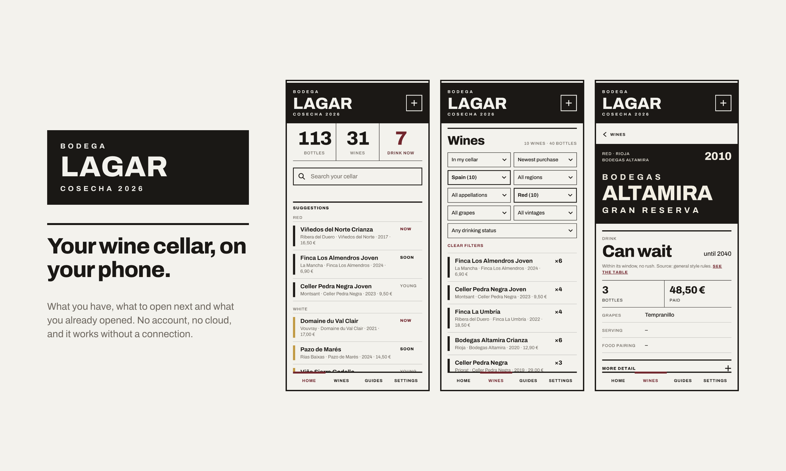
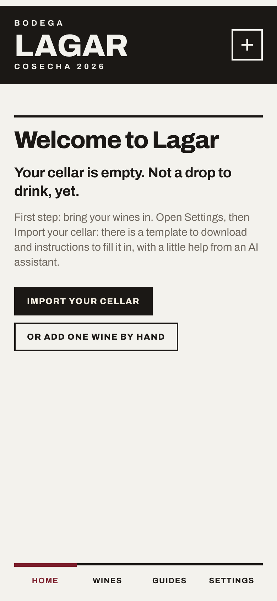
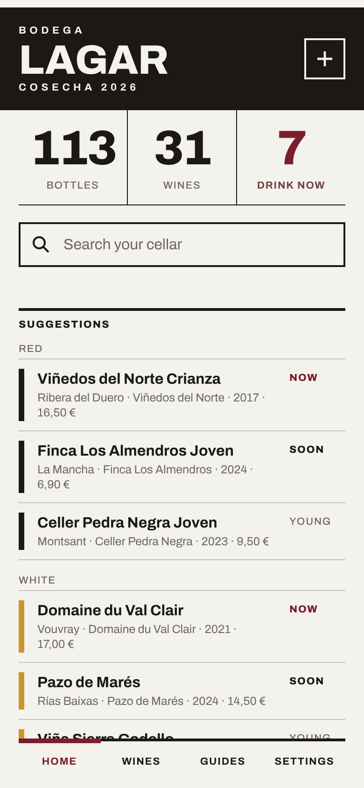
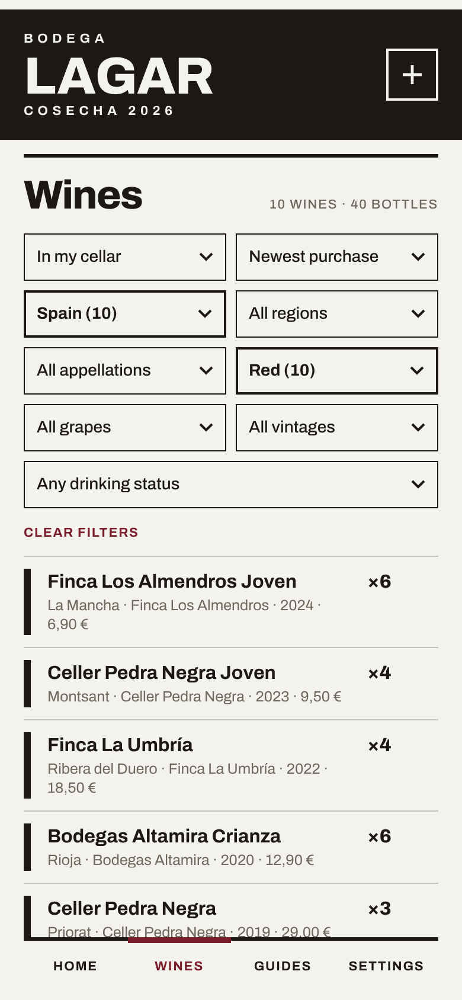
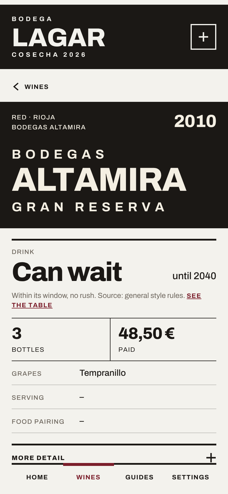
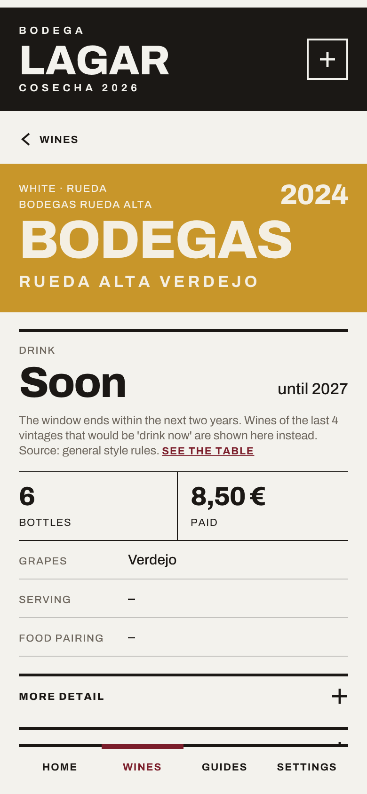

# Lagar app



When you start having a good number of bottles of wine, even if your cellar is small, you start needing to manage it, if you are someone who enjoys wine. Maybe a bottle gets forgotten in a corner, maybe you miss the ideal time of consumption of another one, maybe you just want something different than what you remember.

Lagar is the word in Galicia for the place where you make wine. It's a small app for a wine cellar. It tells you what you have, what to open next and what you already opened.
I built it for my own cellar, because I wanted something quick to use at the moment of choosing a bottle, and then shaped it so other people can bring their own wines.

This is the on-device version: **your cellar lives on your phone**. You install it on the home screen like any app, it works without a connection, and there are no accounts, no cloud and no tracking.

**Open it:** https://ronsel-eu.github.io/lagar-app/

The first version, a Python web app that runs on your own computer, lives in the [`lagar`](https://github.com/ronsel-eu/lagar) repository. It is still the reference for the drinking-advice rules.

## Screens

<p>
  
  
  
  
  
</p>

## What it does

- **Home.** Bottles, wines and how many are ready to drink now. A search box, a few random suggestions (red and white, tagged *now*, *soon* or *young*) and the wines that are ready to drink.
- **Wines.** The whole cellar, with filters (country, region, appellation, type, grape, vintage, drinking status) and order (newest or oldest purchase, price, critic points). Each filter only offers what still fits the others, with counts. One row per wine and vintage.
- **A wine.** Bottles, price paid and the drinking advice with its source. Add, edit or delete wines, and open a bottle with an optional occasion and note, with Undo.
- **Opened.** Every bottle you have opened, newest first.
- **Guides.** Short pages on drinking windows by region, styles of Riesling, decanting and serving temperatures.
- **Languages.** English, Spanish, French and Italian.

### Drinking advice

Each wine has a status: *drink now*, *drink soon*, *can wait*, *keep* or *evolves* (sherry, for example). The wine page says where it comes from:

1. **Your own window**, if you set one when editing the wine. It always wins.
2. Otherwise the **style rules**: tables by region and appellation, then general rules by wine type (see the *Drinking windows* guide in the app).

Recent vintages (the last four years) go to *drink soon* rather than straight to *drink now*. The advice is a guide, not a promise: if you disagree, edit the wine.

## Install it on your phone

Open the link above on your phone, once, with a connection.

- **Android (Chrome):** Settings → *Install the app*, or the ⋮ menu → *Install app*.
- **iPhone and iPad (Safari):** Share button → *Add to Home Screen*.

After that it opens like any app, full screen, and works offline.

## Bring your own cellar

Go to **Settings → Import your cellar**. There are three steps on one page: download a CSV template, optionally copy a prompt that helps an AI assistant fill it from your spreadsheet, notes or photos, and upload the file. You see a preview of every row (new, restock, same, skipped) and nothing is saved until you confirm. Tap the button once and wait for it to finish.

- Only **name**, **vintage** and **bottles** are required. The vintage is a year, or `NV` typed by you. It is never guessed.
- Template columns: `name, vintage, bottles, type, producer, country, region, appellation, grapes, paid, purchase_date`. Optional extra columns: `drink_from`, `drink_to` (your own window), `points` (critic points, 50 to 100), and the wine's details: `abv`, `format_cl`, `serving_temperature`, `food_pairing`, `appearance`, `nose`, `palate`, and `critic` (who gave the points, for example Parker). Details only fill wines that are new to your cellar.
- Importing a wine you already have **adds** the bottles in the file to your stock. Nothing is ever deleted.
- **Want to try it first?** On an empty cellar, *Try a sample cellar* loads 31 made-up wines (about 50 bottles) of every type.

## Your data

Your wines are stored **in the browser of the device where you use the app**. They are not sent anywhere.

- Each device, and each browser on it, keeps its own cellar. An installed app on Android shares its data with Chrome.
- **Back them up.** Settings → *Export backup* saves a file with everything (wines and opened bottles). *Restore backup* loads it on the same or another device. This is also how you move your cellar between devices.
- Clearing the site data in the browser deletes the cellar. Private windows do not keep it.

## For developers

You need Node 22 or newer.

```
npm install
npm run dev        # development server (use the "Network" address on your phone)
npm test           # unit tests (vitest)
npm run check      # svelte-check and TypeScript
npm run build      # production build into dist/
```

Pushing to `main` runs the tests, builds, and publishes to GitHub Pages (`.github/workflows/deploy.yml`). Settings shows the build time of the version you are running.

```
src/components/   screens and pieces of screens (Svelte 5)
src/lib/          the logic, without screens: advice engine, import, browse and filters, storage, backup, i18n
src/guides/       the guides, one markdown file per language
public/           manifest and icons
tools/            service worker generator, font generator, and the scripts that build the fixtures
```

- **Storage.** IndexedDB behind a small `LagarStorage` interface, with an in-memory fallback.
- **Offline.** `tools/sw-plugin.ts` writes `sw.js` at build time: every built file is cached under a version that changes with the content, and an update replaces the old copy.
- **Parity with the original.** The advice engine and the importer are ports of the Python versions, checked against golden files generated from it (`tools/make_golden.py`, `tools/make_import_golden.py`; they need a checkout of the original `lagar` repository). The interface texts come from its `app/i18n.py` through `tools/make_i18n.py`; texts added since are in `src/lib/i18n/extra.ts`.
- **Routing.** A tiny router on the URL hash (`#/wines?country=Spain`), so it works from any sub-path without server rules.
- **Font.** Archivo, served from the app itself (`@fontsource/archivo`), so there are no external requests.

## Design

Personal tool about something I love: less is more, focus on use, little ornament. Chalk background, Archivo, one colour band per wine type, a nod to the Viña Tondonia labels. The designs were made in Paper. See [DESIGN.md](DESIGN.md) for how it is built and why.

## Not built yet

- Moving the cellar between devices automatically. For now it is a backup file.
- Android and iOS app-store versions (planned with Capacitor).
- Possibility to share wines.
- Connection to e-commerce sites.
- Value of your cellar.

## Licence

MIT, see [LICENSE](LICENSE). The Archivo font is under the SIL Open Font License. Wine data you import stays yours.
